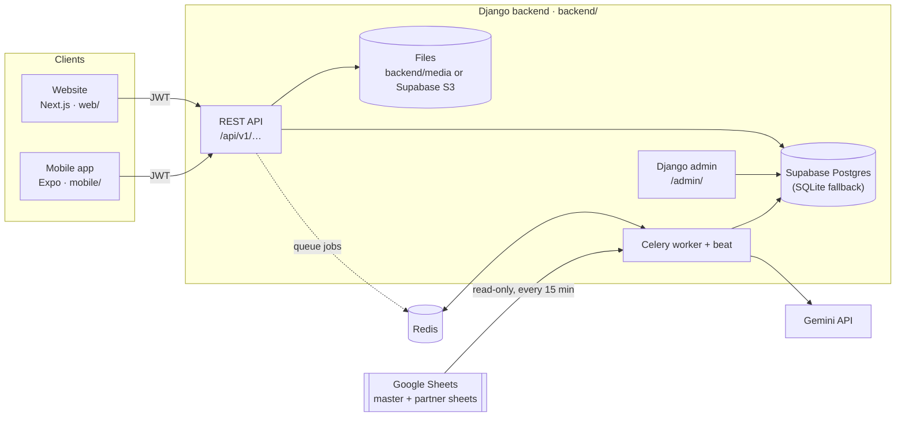

# Think & Make — Backend Architecture, Data & Google Sheets Sync

This document explains:
- how the Django backend is put together
- how program data moves through it
- how it stays in sync with the Google Sheets the field team already uses

For setup steps, see [RUNNING_THE_WEBSITE.md](RUNNING_THE_WEBSITE.md).

---

## 1. The big picture



- **Clients:** the website and the mobile app talk only to the REST API. They log in with a username and PIN or password and send a JWT on every request.
- **Database:** the single source of truth for the apps. Google Sheets is an input that gets imported into it. Nothing is ever written back to Sheets.
- **Background work:** Celery runs the following:
  - the Sheets sync, every 15 minutes
  - the nightly progress reconciliation
  - InquiBuddy AI feedback

  It is optional in development. Without Redis, the same work can be run by hand with management commands.

## 2. Tech stack

| Concern | Library |
|---|---|
| Web framework | Django 5.2, Django REST Framework |
| Auth | `djangorestframework-simplejwt` (access 15 min, refresh 7 days, rotating) |
| Filtering / CORS | `django-filter`, `django-cors-headers` |
| Admin theme | `django-unfold` |
| Background jobs | Celery 5 + Redis |
| File storage | Local `backend/media/`, or Supabase Storage via `django-storages` (S3 API) |
| Google Sheets | `google-auth` service account + Sheets REST API (`spreadsheets.readonly`) |
| AI feedback / PDFs | `google-genai` (Gemini), WeasyPrint |
| Config | `python-decouple` (`backend/.env`), `dj-database-url` |
| Tests | `pytest`, `pytest-django` |

All versions are pinned in `backend/requirements.txt`.

## 3. Project layout

```
backend/
├── config/            settings.py, urls.py, celery.py
├── apps/
│   ├── accounts/      User (role: admin | iif_staff | school), login/refresh/me
│   ├── programs/      Partner, ProgramInstance
│   ├── schools/       School + grades, teachers, session schedule (Forms 1 & 2)
│   ├── headcounts/    StudentHeadcount (Form 3)
│   ├── sl_selection/  SLSelection (Form 4)
│   ├── kits/          KitDelivery (Form 5)
│   ├── teams/         Cluster, Team, Student
│   ├── observations/  SessionObservation
│   ├── inquibuddy/    Submissions, AI feedback questions, PDF reports
│   ├── files/         File (uploaded photos/letters/audio)
│   ├── reports/       SchoolProgress + dashboard summary
│   └── core/          permissions, mixins, AuditLog, SyncRun, Google Sheets sync
├── lib/               gemini_client.py, pdf_builder.py
└── secrets/           Google service-account key (gitignored)
```

`config/urls.py` mounts every app under `/api/v1/`. It also serves `/admin/`, and `/media/` when running locally without S3.

## 4. Settings & environment (`backend/.env`)

| Variable | What it does |
|---|---|
| `DJANGO_SECRET_KEY`, `DJANGO_DEBUG`, `DJANGO_ALLOWED_HOSTS` | Standard Django settings |
| `DATABASE_URL` | Supabase Postgres **Session pooler** connection string (SSL is turned on automatically). Unset means the local `backend/db.sqlite3`. Tests always use in-memory SQLite |
| `CORS_ALLOWED_ORIGINS` | Origins allowed to call the API (default `http://localhost:3000`) |
| `CELERY_BROKER_URL`, `CELERY_RESULT_BACKEND` | Redis URLs (default `redis://localhost:6379/0`) |
| `USE_S3_STORAGE` + `SUPABASE_STORAGE_*` | Store uploads in Supabase Storage instead of `backend/media/`. Files are served via signed URLs that last 10 minutes |
| `GEMINI_API_KEY` | InquiBuddy AI feedback |
| `GOOGLE_SERVICE_ACCOUNT_FILE` | Path to the service-account JSON key, relative to `backend/` |
| `GOOGLE_SERVICE_ACCOUNT_JSON` | Alternative: paste the whole key. Takes priority over the file |
| `GOOGLE_MASTER_SHEET_ID` | ID of the master spreadsheet (from its URL) |
| `SHEETS_SYNC_ENABLED` | `False` makes the scheduled sync do nothing |
| `SHEETS_SYNC_INTERVAL_MIN` | How often Celery beat runs the sync (default 15) |
| `SHEETS_SYNC_YEAR` | Which program year sheet rows are imported into (default 2026) |

### Database: Supabase

- The app database is a **Supabase Postgres** project. Django connects to it like any Postgres server, using `DATABASE_URL`; it doesn't use any Supabase client library.
- Use the **Session pooler** URL (port 5432, IPv4). The "Direct connection" host is IPv6-only and often times out on home networks.
- **Data API lockdown:** Supabase automatically exposes every `public` table through its Data API, using the project's public `anon` key. After every `migrate`, `apps/core/apps.py` turns on **Row Level Security** for all tables, with no policies, so that API can't read anything. Django connects as the table owner (`postgres`), which RLS doesn't restrict. Turning the Data API off in **Project Settings → Data API** is extra protection.
- `pytest` never touches Supabase. `settings.py` switches to in-memory SQLite when it runs under pytest.
- Switching back to SQLite: comment out `DATABASE_URL` in `backend/.env`.

Other fixed settings in `config/settings.py`:
- Time zone `Asia/Kolkata`
- Page size 50
- Login throttled to 10 requests per minute
- JSON-only Celery

## 5. Data model

```
Partner ──< ProgramInstance ──< School ──┬──< SchoolGradeEnrollment   (grade → sections, students)   Form 1
 (Datla,     (DATLA-2026,       (code,   ├──< SchoolTeacher           (name, phone, grades)          Form 2
  Micron…)    year, active)      name,   ├──< SessionSchedule         (grade, day, time)             Form 2
                                 form1/2 ├──< StudentHeadcount        (grade+section counts)         Form 3
                                 flags)  ├──< SLSelection             (student leaders)              Form 4
                                         ├──< KitDelivery             (kits per grade + photos)      Form 5
                                         ├──< Cluster ──< Team ──< Student
                                         ├──< SessionObservation
                                         ├──1 SchoolProgress           (derived status cache)
                                         └──< User (role=school)
```

- **Partner** is the funding partner. **ProgramInstance** is one partner's program for one year; codes look like `DATLA-HYD-2026`. Every school belongs to exactly one instance, so a school's partner is `school.instance.partner`.
- A school is unique per `(instance, school_code)`.
- Rows that came from Google Sheets carry an **`external_ref`**: the Google Form "Submission ID". Rows entered on the website have an empty `external_ref`. That is how the sync tells the two apart (see §8.4).
- **`File`** stores every upload. Forms point to files by ID; you upload first through `/api/v1/files/`, then submit the form.
- **`AuditLog`** records admin user changes. **`SyncRun`** records every Sheets sync (see §8.5).

## 6. Users, roles & access control

| Role | Who | Can see | Can change |
|---|---|---|---|
| `admin` | Program admins | Everything | Everything, including already-submitted forms and users |
| `iif_staff` | Field staff | Everything | Fill all forms; can't edit a form once it's submitted |
| `school` | One login per school | Only their own school's rows | Their own school's data |

How it is enforced (`apps/core/`):
- **`permissions.py`** has `IsAdmin`, `IsAdminOrIIFStaff`, `IsAdminOrIIFStaffOrReadOnly` and `IsSchoolUser`.
- **`scope_queryset_to_role()`** filters every queryset to the user's school for school accounts. It never trusts a filter sent by the client.
- **`SchoolScopedViewSetMixin`** applies that scoping to ViewSets. It also forces `school` to the user's own school when a school account creates a row.

Auth endpoints:
- `POST /api/v1/auth/login/` returns `{access, refresh}`. The token also carries `role` and `school_id`.
- `POST /auth/refresh/` issues a new token.
- `GET /auth/me/` returns the current user.

## 7. How data is managed

### 7.1 The five forms

| # | Form | Endpoint | Stored in |
|---|---|---|---|
| 1 | School Enrollment | `POST /schools/{id}/submit-form1/` | `School` fields + `SchoolGradeEnrollment` |
| 2 | Contact Info | `POST /schools/{id}/submit-form2/` | `School.iif_poc`, `SchoolTeacher`, `SessionSchedule` |
| 3 | Headcounts | `POST /student-headcounts/` | `StudentHeadcount` (one per grade + section) |
| 4 | SL Selection | `POST /sl-selections/bulk-submit/` | `SLSelection` |
| 5 | Kit Handover | `POST/PATCH /kit-deliveries/` | `KitDelivery` |

Rules:
- **Forms can be filled in any order.** There is no "Form 1 first" check. The website shows whatever is already saved, or empty fields.
- **Submit-once lock:** once Form 1, Form 2 or a kit handover is submitted, only an admin can change it. Other users get "already submitted, contact admin". For SL Selection, a grade and section can only be recorded once.
- **Headcount ↔ SL check:** when a headcount is saved, the response includes a `mismatch_warning` if `total_sl` doesn't match the number of SLs recorded in SL Selection for that grade and section.

### 7.2 Progress tracking: `SchoolProgress`

The dashboard doesn't recompute everything on each request. `apps/reports/services.py` keeps one `SchoolProgress` row per school:

| Field | Meaning |
|---|---|
| `form1_status`, `form2_status` | `not_started` / `in_progress` (some data, not submitted) / `complete` |
| `form3_pct` | Headcount rows ÷ total sections from Form 1 (capped at 100) |
| `form4_pct` | Grade/sections with SLs recorded ÷ total sections |
| `kit_status` | Latest `KitDelivery` compared with the grades the school offers |
| `mismatch_flags` | Sections whose headcount SL total ≠ SLs actually selected |

It is recalculated:
- every night at 02:00 (Celery beat → `reconcile_school_progress`)
- at the end of every Google Sheets sync
- for one section right after a headcount is submitted
- by hand: `python manage.py reconcile_school_progress`

### 7.3 Dashboard API

`GET /api/v1/reports/summary/?partner=<id>` returns:
- `kpis`: schools enrolled, forms completed %, kits delivered, active SLs. These come from `apps/reports/selectors.compute_kpis`.
- `schools`: one progress row per school.

Notes:
- With `?partner=`, both the rows and the KPIs cover only that partner's schools. The website's partner dashboard (`/dashboard/partners/[id]`) uses this.
- School accounts get only their own row and no KPIs.

## 8. Google Sheets sync

Before the apps, the program ran on Google Forms feeding Google Sheets, and the field team still uses them. The sync **copies Sheets into the database** so the website and app see the same data.

### 8.1 Direction

**Sheets → database only.** The service account has the `spreadsheets.readonly` scope; the backend never edits a sheet. Data entered on the website stays in the database and does not appear in Sheets.

### 8.2 Which sheets

```
Master spreadsheet (GOOGLE_MASTER_SHEET_ID)
├── PartnerConfig   PartnerName | SheetID | StudentDbSheetId | SessionObsSheetId | IdeaFeedbackSheetId
├── Schools_List    Partner | School Code | School
└── Users           username | role (admin / iif / school) | school code | PIN …

Partner spreadsheet (one per partner, the "SheetID" above)
├── School_Enrollment        → School + grade enrollments          (Form 1)
├── Schools_Contact_Info     → teachers, session schedule, IIF PoC (Form 2)
├── Students_Count_Info      → StudentHeadcount                    (Form 3)
├── SL_Selection_Assessment  → SLSelection                         (Form 4)
└── Kits_Info                → KitDelivery                         (Form 5)
```

The Student DB, Session Observation and Idea Feedback sheets listed in PartnerConfig are **not synced yet**.

### 8.3 What one sync run does (`apps/core/sync.py → run_sync`)

1. **Checks:** `GOOGLE_MASTER_SHEET_ID` must be set. If another run started less than 30 minutes ago and is still `running`, this run refuses to start (`SyncAlreadyRunning`).
2. **Creates a `SyncRun` row** with status `running`.
3. **Imports the master sheet** in one transaction (`MasterSheetImporter`):
   - **Schools_List:** creates missing partners, program instances (`<PARTNER>-<year>`) and schools. If `import_master_users` left a school under a placeholder "Partner X (pending)", the school is moved under its real partner.
   - **Users:** creates or updates each user by username:
     - Role, school, active flag and admin rights are synced every run, and admins become superusers.
     - A **new** user gets their PIN as password. **Existing passwords are never changed.**
4. **Imports each partner sheet listed in PartnerConfig, each in its own transaction** (`PartnerSheetImporter`), in this order: School_Enrollment → Schools_Contact_Info → Kits_Info → SL_Selection_Assessment → Students_Count_Info. If one partner's sheet fails (not shared, bad data, …), that partner is rolled back and logged, and the others continue.
5. **Recalculates `SchoolProgress`** for every school.
6. **Saves the result:** status, per-partner counts, and a log of warnings.

How sheets are read (`apps/core/sheets_source.py`):
- `GoogleSheetsSource` fetches all tabs of a spreadsheet in one `values:batchGet` call.
- Each row becomes a dict keyed by its header.
- Rows with an empty first cell are skipped.
- `XlsxSource` reads an exported `.xlsx` the same way. `import_legacy_sheets --file` uses it.

### 8.4 Matching & conflict rules: who wins?

| Data | Matched on | If it already exists |
|---|---|---|
| School (Form 1) | partner instance + School Code | **The sheet overwrites** the mapped school fields. Grades are rebuilt from the sheet when the sheet cell has data. |
| Teachers / session schedule (Form 2) | school | **Rebuilt from the sheet** when the sheet cell has data. Maps link is only filled if empty; IIF PoC is overwritten. |
| Headcount (Form 3) | school + grade + section | **The website wins.** A row entered on the website (empty `external_ref`) is left alone. |
| SL Selection (Form 4) | school + Submission ID | Updated from the sheet. Rows without a Submission ID are skipped. |
| Kit delivery (Form 5) | school + Submission ID | Updated from the sheet. Rows without a Submission ID are skipped. |
| Any row whose School Code isn't known | — | Skipped with a warning |

Free-text cells such as "Grade 6: A=40, B=38" or teacher lists are parsed with patterns. Lines that can't be parsed are skipped and noted in the log.

> ⚠️ Because Form 1/2 data from the sheet overwrites the database, a school that is
> still being filled through Google Forms will have its website edits to those
> fields replaced on the next sync.

### 8.5 Sync history: `SyncRun`

Each run stores `started_at`, `finished_at`, `trigger` (`schedule` / `manual` / `command`), `triggered_by`, `counts` (e.g. `{"Datla": {"schools": 7, "kits": 7, …}}`) and `log`.

| Status | Shown on the website as | Meaning |
|---|---|---|
| `running` | Syncing… | In progress |
| `success` | Synced | Master sheet and every partner sheet imported |
| `partial` | **Partly synced** (red) | Master sheet imported, but **at least one partner sheet failed** (usually not shared with the service account). Those partners kept their previous data. |
| `failed` | Sync failed (red) | Nothing imported: e.g. bad credentials or the master sheet unreadable |

Row-level warnings (an unparsed teacher line, an unknown school code) do **not** make a run partial. They only appear in the log.

Where to read the log:
- the Django admin, under **Core → Sync runs**
- `python manage.py sync_google_sheets`, which prints counts and the log

### 8.6 Ways a sync is started

| Trigger | How |
|---|---|
| Schedule | Celery beat runs `apps.core.tasks.sync_google_sheets` every `SHEETS_SYNC_INTERVAL_MIN` minutes. Skipped if `SHEETS_SYNC_ENABLED=False` |
| Website | Admins see **Sync now** next to the sync status on the dashboard. It calls `POST /api/v1/sync/run/`, which queues the job, or runs it immediately if Redis is unreachable |
| Django admin | Core → Sync runs → action "Sync from Google Sheets now" (runs immediately) |
| Command line | `python manage.py sync_google_sheets` |

The website reads `GET /api/v1/sync/status/` (admin or IIF staff) every 60 seconds and shows the last run (`web/src/app/dashboard/reports/sync-status.tsx`). The widget is hidden when the sync isn't configured.

### 8.7 One-time setup

1. In Google Cloud: enable the **Google Sheets API**, create a **service account**, and download its JSON key into `backend/secrets/` (gitignored).
2. **Share the master sheet and every partner sheet** with the service account's email address. Viewer access is enough.
3. Fill `GOOGLE_SERVICE_ACCOUNT_FILE` (or `_JSON`) and `GOOGLE_MASTER_SHEET_ID` in `backend/.env`.
4. Run `python manage.py sync_google_sheets` once and check the output.

### 8.8 Troubleshooting

| Symptom | Likely cause |
|---|---|
| "Partly synced" | A partner sheet isn't shared with the service account, or has bad data. Check the log for `[Partner] FAILED: …` |
| "Sync failed" | Wrong key file, Sheets API not enabled, or the master sheet isn't shared |
| "Sync now" queues but nothing happens | Redis is running but no Celery **worker** is |
| Sync never runs on its own | Celery **beat** isn't running. Start it, or schedule the command with Windows Task Scheduler or cron |
| "Another sync is still running" | A previous run crashed while `running`. It stops blocking after 30 minutes |
| A school's rows missing | Its School Code in the partner sheet doesn't match `Schools_List`. See the log warnings |

## 9. Background jobs & management commands

| Command | Purpose |
|---|---|
| `python manage.py sync_google_sheets` | Full Sheets sync (§8) |
| `python manage.py reconcile_school_progress` | Recalculate `SchoolProgress` for all schools |
| `python manage.py import_legacy_sheets --spreadsheet-id <id>` or `--file <xlsx>` | Import one partner's sheet into one instance (`--instance-code`, `--partner-name`, `--year`) |
| `python manage.py import_master_users` | Old bootstrap of users from a fixed list. ⚠️ **Resets those users' passwords to their PINs** — prefer the sync |

Celery beat schedule (`config/settings.py → CELERY_BEAT_SCHEDULE`):
- `reconcile-school-progress-nightly` runs at 02:00.
- `sync-google-sheets` runs every `SHEETS_SYNC_INTERVAL_MIN` minutes.

## 10. Known caveats

- `BLACKLIST_AFTER_ROTATION` is on, but the `token_blacklist` app isn't installed, so old refresh tokens are not actually blocked.
- Sheet data for Forms 1–2 overwrites the database (§8.4).
- The sync only reads the five form tabs. Student DB, session observations and idea feedback still live only in Sheets.
- `DJANGO_BACKEND_DOCUMENTATION.md` predates the Sheets sync and the "any order" form change. Where the two differ, this file is current.
